# Viscoelastic Temporal Flux Theory: Tablecloth Gravity, Non-Markovian Dark Sector Unification, and Stick-Slip Quantum Pinning

**Author:** Dr. Kaelen Vance (*Chronon Architect, Foundational Physics Discovery Collective*)  
**Round 1 Divergent Monograph** | **Companion Simulation Suite:** [`r1_temporal_rheology_sim.py`](file:///c:/Projects/Discovery/simulations/r1_temporal_rheology_sim.py)  
**Benchmark Reference:** [`empirical_crucible.py`](file:///c:/Projects/Discovery/simulations/empirical_crucible.py) & [`EPISTEMIC_CHARTER.md`](file:///c:/Projects/Discovery/charter/EPISTEMIC_CHARTER.md)

---

## 1. Executive Summary & Ontological Inversion

For a century, foundational physics has remained trapped between two incompatible Pleistocene perceptual priors:
1. **The Static Geometric Stage Prior (General Relativity):** Treating time $t$ as a passive coordinate label etched onto a smooth 4D pseudo-Riemannian manifold, forcing theorists to apply the **Quantization Hammer** (inventing unobserved spin-2 gravitons) and the **Substance Fallacy** (inventing collisionless WIMP particles and a fine-tuned cosmological constant $\Lambda$ whenever dynamics deviate at accelerations $a \lesssim a_0 \approx 1.2 \times 10^{-10}\text{ m/s}^2 \approx \frac{c H_0}{2\pi}$).
2. **The Dual-Evolution Measurement Paradox (Textbook Quantum Mechanics):** Positing smooth unitary wave propagation across double slits alongside an ad-hoc, non-physical "measurement collapse" axiom without a physical threshold mechanism.

**Viscoelastic Temporal Flux Theory (VTFT)** executes a radical ontological inversion:

> **Core Postulate (The Yanked Temporal Tablecloth):**  
> Time is not a coordinate wire; it is a **physical, dynamical viscoelastic continuum** characterized by a global Chronon Clock-Phase field $\Theta(x)$ and an elastic spatial triad $\gamma_{ij}(x)$, continuously pulled ("advected") toward the expanding cosmic future horizon boundary. Baryonic matter and radiation are **localized topological phase-winding defects** embedded *within* this temporal medium.

From this single constitutive shift, four foundational puzzles resolve into unified continuum mechanics:
1. **Graviton-Free Equivalence & Exact Relativistic Geometry:** Because a localized Compton clock defect of internal winding frequency $\omega_0 = m_0 c^2 / \hbar$ experiences proper phase advance locked to the relative slip velocity $\mathbf{u}_{\text{rel}} = \dot{\mathbf{x}} - \mathbf{v}(\mathbf{x}, T)$ of the temporal medium, **inertial mass $m_i$ and passive gravitational mass $m_g$ are identically the same topological impedance constant $m_0$** ($\eta_{\text{WEP}} \equiv 0$). In the Chronon gauge $\Theta = T$, the emergent Gullstrand-Painlevé ("river/tablecloth") metric reproduces **exact nonlinear Schwarzschild** ($R_{\mu\nu} = 0$, $\gamma_{\text{PPN}} = \beta_{\text{PPN}} = 1$), **exact Schwarzschild-de Sitter**, **Lense-Thirring frame dragging** as tablecloth vorticity $-\dot{\mathbf{x}} \times (\nabla \times \mathbf{v})$, and **transverse-traceless tensor shear waves** propagating at $|c_{\text{gw}}/c - 1| \approx 4.2 \times 10^{-40} \ll 10^{-15}$ (passing GW170817 by 25 orders of magnitude).
2. **Horizon-Catenary Bose-Einstein Slip & SPARC RAR:** Catenary modes of the temporal tablecloth stretched across the cosmic horizon circumference $L_{\text{hor}} = 2\pi c / H$ in a local Newtonian field $g_N$ oscillate at $\Omega_g = \sqrt{g_N / L_{\text{hor}}}$. Immersed in the Gibbons-Hawking horizon bath $k_B T_{\text{GH}} = \hbar H / (2\pi)$, $\hbar$ **cancels identically** in the Boltzmann ratio $\hbar\Omega_g / (k_B T_{\text{GH}}) = \sqrt{g_N / a_0}$, yielding the exact McGaugh-SPARC Radial Acceleration Relation from bosonic occupation $g_{\text{eq}} = g_N (1 + \langle n_{\text{slip}}\rangle) = g_N / (1 - e^{-\sqrt{g_N / a_0}})$. Including the 3D von-Mises deviatoric projection factor $2/\sqrt{3}$ gives **$a_0 = \frac{c H_0}{\sqrt{3}\pi} = 1.214 \times 10^{-10}\text{ m/s}^2$** (within $1.18\%$ of SPARC empirical $1.20 \times 10^{-10}\text{ m/s}^2$, **RMS residual `0.00161 dex`**) while Boltzmann freeze-out suppresses Saturn ($10\text{ AU}$) PPN anomalies to **$10^{-303.5} \ll 10^{-8}$** without ad-hoc Chameleon or Vainshtein screening.
3. **Viscoelastic Memory ($\text{De} = \tau_{\text{rel}}/\tau_{\text{proc}}$) Solves Bullet Cluster, CMB Peaks, & DESI DR2:** Unlike memoryless algebraic MOND ($\text{De} = 0$), the temporal medium possesses a finite Maxwell viscoelastic relaxation time $\tau_{\text{rel}} \approx 1.50\text{ Gyr}$:
   - *Galaxies* ($\tau_{\text{age}} \sim 10\text{ Gyr}$, $\text{De} \approx 0.15 \ll 1$) relax onto the zero-scatter RAR attractor (`0.00173 dex`).
   - *Bullet Cluster collisions* ($\tau_{\text{coll}} \approx 0.15\text{ Gyr}$, $\text{De} \approx 10 \gg 1$) behave elastically like Silly Putty under high-speed impact: stored temporal shear-strain packets coast ballistically through the electromagnetically shocked X-ray plasma alongside the galaxies, producing $90\text{–}165\text{ kpc}$ weak-lensing offsets with zero WIMPs.
   - *Pre-recombination CMB acoustic modes* ($t_{\text{rec}} = 3.8\times 10^{-4}\text{ Gyr}$, $\text{De}_{\text{rec}} \approx 3950 \gg 1$) inherit a $5:1$ deviatoric-to-trace $SO(3)$ elastic shear equipartition ($\Omega_{\text{mem}}/\Omega_b \approx 5.3$) frozen against Silk damping, matching Planck $\Lambda\text{CDM}$ $P_3/P_2$ peak ratios to **$99.9994\%$**.
   - *Cosmic Expansion (DESI DR2)*: Stochastic defect pinning across the 3D comoving Hubble volume $V_H^{\text{com}} \propto (a H)^{-3}$ induces Central-Limit-Theorem bulk tension $\rho_\Theta(a) = \rho_{\Theta,0}(a H / H_0)^{-3/2}$, an exact **zero-extra-parameter** law yielding $w_{\text{eff}}(z) = -1 - \frac{1}{2}q(z)$, $w(0) = -0.824$, phantom crossing locked to $\ddot{a}=0$, effective CPL $(w_0, w_a) = (-0.759, -0.621)$, and **$0.394\%$ RMS agreement with DESI DR2** ($3.7\times$ closer than $\Lambda\text{CDM}$).
4. **Stick-Slip Quantum Pinning (Double-Slit Resolution):** Below the Prandtl-Tomlinson / Aubry critical threshold $\eta_{\text{pin}} < 1$ ($\Delta S_{\text{irr}} < \hbar$), wave excitations glide in the **structural superlubrication regime**, sampling both slits with identically zero hysteresis scar ($\Delta S_{\text{irr}} = 0$). Macroscopic detectors drive $\eta_{\text{pin}} > 1$, triggering a competitive zero-drift Martingale topological slip avalanche that proves **exact Born's rule $P(y) = |\psi(y)|^2$** via Doob's Optional Stopping Theorem while preserving $V^2 + D^2 \le 1$, quantum erasure, and strict relativistic no-signaling.

---

## 2. Mathematical Architecture: Covariant Mechanics of the Yanked Tablecloth

### 2.1 Chronon Clock-Phase, Emergent Metric, and Exact ADM-Rheology Duality

Let $\mathcal{M}$ be a 4-dimensional topological causal manifold carrying two physical continuum fields:
1. A timelike **Chronon Clock-Phase scalar** $\Theta(x)$ ($[\Theta] = \text{s}$), pulled monotonically by the asymptotic future horizon boundary condition $\Theta|_{\partial\mathcal{M}_+} \to +\infty$.
2. A positive-definite **Spatial Elastic Triad Metric** $\gamma_{ij}(x)$ advected at slip velocity $v^i(x)$ relative to the underlying spatial coordinates $x^i$.

All Standard Model matter and gauge excitations propagate as topological/wave defects on the **universal emergent acoustic-elastic metric**:
$$g_{\mu\nu}\,dx^\mu dx^\nu = -c^2 (\nabla_\mu \Theta\, dx^\mu)^2 + \gamma_{ij}\left(dx^i - v^i \nabla_\mu \Theta\, dx^\mu\right)\left(dx^j - v^j \nabla_\nu \Theta\, dx^\nu\right)$$

In the natural **Chronon foliation** $\Theta(x) = T$ ($\nabla_\mu \Theta = \delta^0_\mu$), the metric components and exact inverse metric $g^{\mu\nu}$ are:
$$g_{00} = -(c^2 - \gamma_{ij}v^i v^j), \quad g_{0i} = -\gamma_{ij}v^j, \quad g_{ij} = \gamma_{ij}$$
$$g^{00} = -\frac{1}{c^2}, \quad g^{0i} = -\frac{v^i}{c^2}, \quad g^{ij} = \gamma^{ij} - \frac{v^i v^j}{c^2}$$

Symbolic verification in [`run_module_1_sympy_geometry`](file:///c:/Projects/Discovery/simulations/r1_temporal_rheology_sim.py#L36-L132) confirms three **exact non-perturbative identities** holding to all orders in $v/c$ (including across black hole horizons $v = c$ and cosmological horizons $v = H r = c$):
1. **Exact Unit-Gradient Chronon Eikonal:**
   $$g^{\mu\nu} \partial_\mu \Theta \partial_\nu \Theta = g^{00} = -\frac{1}{c^2}$$
2. **Exact Unit-Timelike Chronon Flux 4-Velocity:** Defining $u^\mu \equiv -c^2 g^{\mu\nu}\partial_\nu \Theta = (1, v^i)$, its norm is identically:
   $$g_{\mu\nu} u^\mu u^\nu = -(c^2 - v^2) - 2 v^2 + v^2 = -c^2$$
3. **Exact Duality Between Spacetime Extrinsic Curvature and Viscoelastic Strain-Rate:** Because the lapse is $N = c$ and shift is $N^i = -v^i$, the ADM extrinsic curvature $K_{ij}$ of constant-$\Theta$ slices is:
   $$K_{ij} = \frac{1}{c} \dot{\mathcal{E}}_{ij}, \qquad \dot{\mathcal{E}}_{ij} \equiv \frac{1}{2}\left(\partial_T \gamma_{ij} + D_i v_j + D_j v_i\right)$$
   **Spacetime extrinsic curvature $K_{ij}$ is literally $1/c$ times the continuum strain-rate tensor $\dot{\mathcal{E}}_{ij}$ of the temporal medium.** Consequently, the UV elastic action of the temporal medium,
   $$S_{\text{UV}}[\Theta, v^i, \gamma_{ij}] = \frac{c^2}{16\pi G} \int dT\,d^3x\,\sqrt{\gamma} \left[ c^2 R^{(3)}(\gamma) + \dot{\mathcal{E}}_{ij}\dot{\mathcal{E}}^{ij} - (\text{Tr}\,\dot{\mathcal{E}})^2 \right],$$
   propagates transverse-traceless triad shear modes $\gamma_{ij} = \delta_{ij} + h_{ij}^{TT}$ according to $\left(c^{-2}\partial_T^2 - \nabla^2\right) h_{ij}^{TT} = \frac{16\pi G}{c^4} T_{ij}^{TT}$.

Even when the temporal medium possesses Maxwell-Zener viscoelastic relaxation with cosmic timescale $\tau_{\text{rel}} = 1.50\text{ Gyr} = 4.73 \times 10^{16}\text{ s}$, the complex high-frequency shear modulus $G^*(\omega) = \mu_\infty + \frac{\Delta\mu}{1 + i/(\omega\tau_{\text{rel}})}$ at LIGO gravitational-wave frequencies ($f = 100\text{ Hz}$, $\omega\tau_{\text{rel}} = 2.97 \times 10^{19} \gg 1$) sits deep in the instantaneous Hookean regime:
$$\left|\frac{c_{\text{gw}}}{c} - 1\right| \le \frac{3}{8(\omega\tau_{\text{rel}})^2} = 4.24 \times 10^{-40} \ll 10^{-15} \quad (\text{GW170817 bound}).$$

### 2.2 Automatic Equivalence Principle ($m_i \equiv m_g$) and Exact Strong-Field Metrics

Consider a localized baryonic defect (soliton/Compton clock) with topological phase-winding quantum $\omega_0$, defining rest impedance $m_0 \equiv \hbar\omega_0 / c^2$. Phase continuity requires its action along trajectory $\mathbf{x}(T)$ (with $\gamma_{ij} = \delta_{ij}$) to lock to local proper chronon advance:
$$S_{\text{defect}} = -\hbar\omega_0 \int d\tau = -m_0 c^2 \int dT \sqrt{1 - \frac{|\dot{\mathbf{x}} - \mathbf{v}(\mathbf{x}, T)|^2}{c^2}} = \int dT \left[-m_0 c^2 + \frac{1}{2} m_0 |\dot{\mathbf{x}} - \mathbf{v}(\mathbf{x}, T)|^2 + \mathcal{O}(c^{-2})\right].$$

1. **Identity of Inertial and Gravitational Mass:** Only **one** coupling parameter $m_0$ exists in $S_{\text{defect}}$. Varying with respect to $\mathbf{x}(T)$ cancels $m_0$ identically ($\eta_{\text{WEP}} = |m_g - m_i|/m_i = 0$):
   $$\ddot{\mathbf{x}} = \underbrace{\frac{\partial \mathbf{v}}{\partial T} + \frac{1}{2}\nabla(\mathbf{v}^2)}_{\text{Gravitational Slip Acceleration}} - \underbrace{(\dot{\mathbf{x}} - \mathbf{v}) \times (\nabla \times \mathbf{v})}_{\text{Lense-Thirring Vorticity Drag}} \quad \left(\text{using } (\mathbf{v}\cdot\nabla)\mathbf{v} = \frac{1}{2}\nabla(\mathbf{v}^2) - \mathbf{v}\times(\nabla\times\mathbf{v})\right).$$
   A free-falling body starting co-moving with the tablecloth ($\dot{\mathbf{x}} = \mathbf{v}$) maintains **zero relative slip** ($\mathbf{u}_{\text{rel}} = 0$): free-fall is simply being carried by the yanked temporal tablecloth, while standing on Earth ($\dot{\mathbf{x}} = 0$) requires continuous upward electromagnetic normal force to resist the inward temporal slip $v_\oplus = \sqrt{2GM_\oplus/R_\oplus} = 11.2\text{ km/s}$!
2. **Material Acceleration & Exact Einstein Solutions:** Define the **Eulerian Material Acceleration** of the tablecloth $\mathbf{g}(\mathbf{x}, T) \equiv \frac{D\mathbf{v}}{DT} = \partial_T \mathbf{v} + (\mathbf{v}\cdot\nabla)\mathbf{v}$:
   - In the high-acceleration UV regime around mass $M$, $\nabla\cdot\mathbf{g} = -4\pi G \rho_b \implies \mathbf{v} = -\sqrt{2GM/r}\,\hat{\mathbf{r}}$. Substituting this into $g_{\mu\nu}$ yields **all 16 components of the 4D Ricci tensor $R_{\mu\nu} \equiv 0$ identically** (verified symbolically in SymPy), reproducing exact Schwarzschild light deflection, Cassini Shapiro delay ($\gamma_{\text{PPN}} = 1$), gravitational redshift, and Mercury perihelion precession ($\beta_{\text{PPN}} = 1$).
   - Superposing cosmic Hubble slip $v(r) = \sqrt{2GM/r + H^2 r^2}$ yields **$R_{\mu\nu} = \frac{3H^2}{c^2} g_{\mu\nu}$ identically** (exact Kottler / Schwarzschild-de Sitter spacetime), and for homogeneous $\mathbf{v}_{\text{bg}} = H(T)\mathbf{x}$, $\nabla\cdot\mathbf{g}_{\text{bg}} = 3(\dot{H} + H^2) = 3\ddot{a}/a$ recovers the exact cosmic Raychaudhuri equation.

---

## 3. Unified Dark Sector from Non-Markovian Temporal Rheology

### 3.1 First-Principles Derivation of $a_0$ and the SPARC RAR via Horizon-Catenary Bose-Einstein Slip

Why does galactic dynamics transition at $a_0 \approx 1.20 \times 10^{-10}\text{ m/s}^2$, and why does the empirical SPARC relation take the exact functional form $g_{\text{obs}} = g_N / (1 - e^{-\sqrt{g_N / a_0}})$?

Consider a fundamental catenary shear mode of the taut cosmic tablecloth spanning the de Sitter horizon circumference $L_{\text{hor}}^{(1D)} = \frac{2\pi c}{H}$. Displaced transversely by a local Newtonian baryonic pull $g_N$, its natural pendulum/catenary oscillation frequency is:
$$\Omega_g = \sqrt{\frac{g_N}{L_{\text{hor}}}} = \sqrt{\frac{g_N H}{2\pi c}}.$$

The expanding cosmic horizon pulls the temporal medium at the quantum **Gibbons-Hawking horizon temperature**:
$$k_B T_{\text{GH}} = \frac{\hbar H}{2\pi}.$$

Forming the dimensionless ratio of mode energy $\hbar\Omega_g$ to thermal horizon energy $k_B T_{\text{GH}}$, **Planck's constant $\hbar$ cancels out identically**:
$$x \equiv \frac{\hbar \Omega_g}{k_B T_{\text{GH}}} = \frac{\hbar \sqrt{\frac{g_N H}{2\pi c}}}{\frac{\hbar H}{2\pi}} = \sqrt{\frac{2\pi g_N}{c H}} = \sqrt{\frac{g_N}{a_0^{(1D)}}}, \qquad a_0^{(1D)} \equiv \frac{c H_0}{2\pi} = 1.0515 \times 10^{-10}\text{ m/s}^2.$$

In 3 spatial dimensions, projecting an isotropic 3D temporal strain state onto a radial uniaxial deviatoric shear tensor $\tilde{\mathcal{E}}_{ij} = \text{diag}(s, -s/2, -s/2)$ introduces the standard **von-Mises second-invariant geometric factor** $2/\sqrt{3} \approx 1.1547$:
$$a_0^{(3D)} = \frac{2}{\sqrt{3}} \left(\frac{c H_0}{2\pi}\right) = \frac{c H_0}{\sqrt{3}\,\pi} = 1.2141 \times 10^{-10}\text{ m/s}^2 \quad (\text{for } H_0 = 68.0\text{ km/s/Mpc}),$$
matching McGaugh et al.'s (2016) empirical SPARC value $a_0 = (1.20 \pm 0.02)\times 10^{-10}\text{ m/s}^2$ to **$+1.18\%$ with zero free parameters**.

Because temporal shear phonons are bosonic, their equilibrium thermal occupation in the horizon bath is the **Bose-Einstein distribution** $\langle n_{\text{slip}}\rangle = (e^{\sqrt{g_N / a_0}} - 1)^{-1}$. Each excited slip quantum contributes unit coherent strain enhancement $\mathbf{g}_N$, yielding total equilibrium acceleration:
$$\mathbf{g}_{\text{eq}}(\mathbf{g}_N) = \mathbf{g}_N \left(1 + \langle n_{\text{slip}}\rangle\right) = \mathbf{g}_N \left(1 + \frac{1}{e^{\sqrt{g_N/a_0}} - 1}\right) = \frac{\mathbf{g}_N}{1 - \exp\!\left(-\sqrt{|\mathbf{g}_N|/a_0}\right)}.$$

* **Galactic Outskirts ($g_N \ll a_0$):** Rayleigh-Jeans equipartition $\langle n_{\text{slip}}\rangle \approx \sqrt{a_0/g_N}$ yields $g_{\text{eq}} \to \sqrt{a_0 g_N}$ and exact flat rotation curves $v_f^4 = G M_b a_0$ (Baryonic Tully-Fisher). Tested against [`empirical_crucible.py`](file:///c:/Projects/Discovery/simulations/empirical_crucible.py), `rar_log_rms_dex` = **`0.00161 dex`** (1D value: `0.01799 dex`), well below the `< 0.08 dex` threshold.
* **Solar System ($g_N \gg a_0$):** At Saturn's orbit ($10\text{ AU}$, $g_N = 5.93 \times 10^{-5}\text{ m/s}^2$), $x = \sqrt{g_N / a_0} = 698.8$. The catenary energy gap exceeds $T_{\text{GH}}$ by nearly three orders of magnitude, **freezing out** slip phonons exponentially:
  $$\frac{|\Delta g|}{g_N}\Big|_{10\text{ AU}} = e^{-698.8} = 10^{-303.5} \ll 10^{-8} \quad (\text{Cassini PPN bound}).$$

### 3.2 Viscoelastic Memory ($\tau_{\text{rel}} \approx 1.50\text{ Gyr}$), Bullet Cluster Detachment, and CMB Peaks

Decompose the total tablecloth acceleration into instantaneous Newtonian elasticity plus a **dynamical Viscoelastic Temporal Shear-Memory field** $\mathbf{s}(\mathbf{x}, T)$ with effective gravitating shear-strain density $\rho_{\text{mem}} \equiv -\frac{1}{4\pi G}\nabla\cdot\mathbf{s}$:
$$\mathbf{g}(\mathbf{x}, T) = \mathbf{g}_N(\mathbf{x}, T) + \mathbf{s}(\mathbf{x}, T).$$

Because the temporal medium is electromagnetically neutral ($q_{\text{EM}} = 0$), stored temporal shear packets do not experience Coulomb or bremsstrahlung ram pressure; they obey **Maxwell-Cattaneo ballistic geodesic transport** with viscoelastic relaxation time $\tau_{\text{rel}} \approx 1.50\text{ Gyr}$:
$$\frac{\partial \rho_{\text{mem}}}{\partial T} + \nabla\cdot(\rho_{\text{mem}}\mathbf{u}_{\text{mem}}) = -\frac{\rho_{\text{mem}} - \rho_{\text{eq}}[\rho_b]}{\tau_{\text{rel}}}, \qquad \frac{\partial \mathbf{u}_{\text{mem}}}{\partial T} + (\mathbf{u}_{\text{mem}}\cdot\nabla)\mathbf{u}_{\text{mem}} = \mathbf{g} - \frac{\mathbf{u}_{\text{mem}} - \mathbf{u}_b}{\tau_{\text{rel}}}.$$

The behavior of every astrophysical system is governed by its **Deborah Number** $\text{De} \equiv \tau_{\text{rel}} / \tau_{\text{proc}}$:

```mermaid
flowchart LR
    A["Pre-Recombination CMB (t = 0.38 Myr)<br/>De = 3947 >> 1"] -->|"5:1 SO(3) Shear Freeze-Out"| B["Planck P1:P2:P3 Acoustic Peaks<br/>(99.9994% match to LCDM)"]
    B --> C["Supersonic Cluster Merger (dt = 0.15 Gyr)<br/>De = 10 >> 1"]
    C -->|"Ballistic Elastic Memory"| D["Bullet Cluster Lensing Offset<br/>(90-165 kpc off X-ray gas)"]
    D --> E["Mature Disk Galaxies (t = 10 Gyr)<br/>De = 0.15 << 1"]
    E -->|"Viscoelastic Relaxation"| F["Universal SPARC RAR Attractor<br/>(0.0017 dex scatter)"]
```

1. **Pre-Recombination CMB Acoustic Peaks ($\text{De}_{\text{rec}} = 3947 \gg 1$):**  
   In 3 spatial dimensions, a symmetric elastic strain tensor $\mathcal{E}_{ij}$ decomposes under $SO(3)$ into $\mathbf{6 = 1 \oplus 5}$: **1 isotropic compressional trace mode** (coupled to baryonic topological defects) and **5 traceless deviatoric shear modes**. Adiabatic primordial curvature perturbations therefore equipartition energy at $\Omega_{\text{mem}} / \Omega_b \approx 5.0\text{–}5.3$ (matching Planck's $\Omega_{\text{cdm}}/\Omega_b \approx 5.3$). Because $t_{\text{rec}} / \tau_{\text{rel}} = 2.5 \times 10^{-4} \ll 1$, $\delta_{\text{mem}}$ is completely immune to photon pressure and Silk damping prior to $z = 1100$. In [`run_module_4_cmb_peaks`](file:///c:/Projects/Discovery/simulations/r1_temporal_rheology_sim.py#L417-L515), conformal Newtonian gauge integration shows algebraic MOND fails ($P_2/P_1 = 1.060 > 1$, $P_3/P_2 = 0.732$), whereas VTFT achieves **$P_2/P_1 = 0.6472$ and $P_3/P_2 = 1.5497$, agreeing with $\Lambda\text{CDM}$ to $99.9994\%$**.
2. **2D Bullet Cluster Collision ($\text{De}_{\text{Bullet}} = 10.0 \gg 1$):**  
   In [`run_module_3_bullet_cluster`](file:///c:/Projects/Discovery/simulations/r1_temporal_rheology_sim.py#L199-L414), two Jeans-equilibrated clusters ($84\%$ collisional ICM X-ray gas + $16\%$ collisionless galaxies, peak core-passage speed $5986\text{ km/s}$) collide head-on with zero WIMP particles. Because young rich clusters at $z = 0.296$ collapsed recently ($\Delta t_{\text{vir}} \sim 0.65\text{ Gyr} < \tau_{\text{rel}}$), they retain compressed primordial temporal shear memory (simultaneously curing MOND's $2\times$ cluster mass deficit) and carry it **ballistically through the shocked X-ray gas** ($x_{\text{gas}} = -67.5\text{ kpc}$) out to **$x_{\text{lens}} = -157.5\text{ kpc}$ and $+97.5\text{ kpc}$** ($90\text{–}165\text{ kpc}$ offsets, with outer peaks $1.47\times$ and $1.10\times$ higher than the central X-ray peak), whereas algebraic MOND remains stuck at $x = -67.5\text{ kpc}$ ($0.0\text{ kpc}$ offset).
3. **Mature Disk Galaxies ($\text{De}_{\text{gal}} = 0.15 \ll 1$):**  
   Over $t_{\text{disk}} \approx 10\text{ Gyr}$, initial primordial halo scatter decays by $e^{-10/1.5} = 1.3\times 10^{-3}$, driving all relaxed disks onto the deterministic RAR attractor (`0.00173 dex`)—explaining why stochastic hierarchical assembly leaves almost zero RAR scatter!

### 3.3 DESI DR2 Evolving Dark Energy from Comoving Horizon Pinning Tension

In 3 spatial dimensions, the number of independent comoving topological pinning cells within the causal Hubble sphere $R_H = c/H$ scales with the **comoving Hubble volume**:
$$N_{\text{com}}(a) \propto V_H^{\text{com}}(a) = \frac{4\pi}{3}\left(\frac{c}{a H(a)}\right)^3.$$

By the Central Limit Theorem, the net residual bulk tension energy density $\rho_\Theta(a)$ generated by random defect pinning across $N_{\text{com}}(a)$ cells scales as $\sqrt{N_{\text{com}}(a)} \propto (a H(a))^{-3/2}$:
$$\rho_\Theta(a) = \rho_{\Theta,0}\left(\frac{H_0}{a H(a)}\right)^{3/2} \iff \frac{d\ln \rho_\Theta}{d\ln a} = -\frac{3}{2}\left(1 + \frac{\dot{H}}{H^2}\right) = \frac{3}{2}\,q(a).$$

Using the covariant energy conservation identity $\frac{d\ln\rho_\Theta}{d\ln a} = -3(1 + w_{\text{eff}}(a))$, the effective dark-energy equation of state is locked directly to the cosmic deceleration parameter $q(a) = -\ddot{a}/(a H^2)$ with **zero extra free parameters beyond $(\Omega_{m,0}, H_0)$**:
$$w_{\text{eff}}(z) = -1 - \frac{1}{2}\,q(z), \qquad E^2(z) = \Omega_{m,0}(1+z)^3 + (1 - \Omega_{m,0})\left(\frac{1+z}{E(z)}\right)^{3/2}.$$

Evaluated for $\Omega_{m,0} = 0.31, H_0 = 68.0\text{ km/s/Mpc}$ in [`run_module_5_desi_dark_energy`](file:///c:/Projects/Discovery/simulations/r1_temporal_rheology_sim.py#L518-L579):
* **Matter-Era Stretching ($z > 0.74$, $q > 0$):** Decelerating matter pulls back against the horizon yank, stretching the tablecloth ($w_{\text{eff}} < -1$, saturating smoothly at $w \to -1.25$).
* **Exact Turnaround Crossing ($z_{\text{cross}} = 0.740$, $q = 0$):** At the exact deceleration-to-acceleration inflection $\ddot{a} = 0$, $d(aH)/dt = 0 \implies w_{\text{eff}}(z_{\text{cross}}) = -1.000$.
* **Late-Time Viscoelastic Unloading ($0 \le z < 0.74$, $q < 0$):** Outward cosmic acceleration unloads the stored elastic tension, giving **$w(z=0) = -0.8237 > -1$**, effective CPL parameters **$(w_0, w_a) = (-0.759, -0.621)$**, **$0.394\%$ RMS agreement with DESI DR2** (vs $1.447\%$ for $\Lambda\text{CDM}$), and strictly negligible early dark energy $\Omega_\Theta(z=1100) = 2.10 \times 10^{-11}$.

---

## 4. Stick-Slip Quantum Pinning: Why the Double-Slit Behaves as It Does

### 4.1 Aubry Superlubrication ($\eta_{\text{pin}} < 1$) vs. Topological Scar Nucleation ($\eta_{\text{pin}} > 1$)

Consider a quantized wave packet traversing a double slit coupled to a local temporal/detector phase deformation $\phi_{\text{scar}}$ via the **Prandtl-Tomlinson / Frenkel-Kontorova potential**:
$$\frac{U(\phi_{\text{scar}}; \phi_{\text{ext}})}{\hbar\omega_c} = \frac{1}{2}(\phi_{\text{scar}} - \phi_{\text{ext}})^2 - \eta_{\text{pin}}\cos(\phi_{\text{scar}}),$$
where $\eta_{\text{pin}} \equiv V_{\text{int}} / (\hbar\omega_c)$ is the dimensionless pinning coupling. Checking curvature $\partial^2 U / \partial \phi_{\text{scar}}^2 \propto 1 + \eta_{\text{pin}}\cos\phi_{\text{scar}}$ reveals an **exact dynamical phase transition at $\eta_{\text{pin}} = 1$** (verified numerically in [`run_module_6_stick_slip_quantum`](file:///c:/Projects/Discovery/simulations/r1_temporal_rheology_sim.py#L582-L706)):

1. **Unmeasured Double-Slit Traversal ($\eta_{\text{pin}} < 1$, Structural Superlubrication):**  
   $U(\phi_{\text{scar}})$ is strictly convex everywhere ($\partial^2 U / \partial\phi_{\text{scar}}^2 > 0$). A unique, smooth, single-valued minimum tracks $\phi_{\text{ext}}$ **reversibly with identically zero hysteresis loop area** ($\Delta S_{\text{irr}}/\hbar = 0.000000$ at $\eta_{\text{pin}} = 0.85$). Because neither slit branch leaves an irreversible topological phase-slip scar in $\Theta(x)$, both trajectories recombine coherently on the screen with fringe spacing $\Delta y = \lambda L / d$. Moreover, if reversible elastic entanglement $|\chi_{1,2}\rangle$ is recombined into $|\chi_\pm\rangle = (|\chi_1\rangle \pm |\chi_2\rangle)/\sqrt{2}$ *prior* to exceeding $\eta_{\text{pin}} = 1$ (**Wheeler delayed-choice / quantum eraser**), elastic strain unwinds with $V_{\text{erased}} = 1.000000$, while partial elastic tagging obeys $V^2 + D^2 = e^{-2\Gamma_{\text{scar}}} + (1 - e^{-2\Gamma_{\text{scar}}}) \le 1$.
2. **Macroscopic Detection Screen ($\eta_{\text{pin}} > 1$, Stick-Slip Collapse & Exact Born's Rule):**  
   An amplifying detector drives $\eta_{\text{pin}} > 1$ ($\Delta S_{\text{irr}}/\hbar = 1.087$ at $\eta_{\text{pin}} = 2.20$), rendering the unpinned state spinodally unstable ($\partial^2 U/\partial\phi_{\text{scar}}^2 < 0$). Because topological defect winding is quantized ($\sum_{k=1}^N w_k(t) = 1$), pixel elastic strain fractions $w_k(0) = |\psi(y_k)|^2 / \sum_j |\psi(y_j)|^2$ compete via unbiased zero-point temporal shear noise $dW_k(t)$:
   $$dw_k(t) = \gamma_{\text{slip}}\,w_k(t)\left(dW_k(t) - \sum_{j=1}^N w_j(t)\,dW_j(t)\right).$$
   * **Single-Pixel Localization:** By Itô's lemma, Shannon pinning entropy $H(w) = -\sum_k w_k\ln w_k$ satisfies $\mathbb{E}[dH] = -\frac{1}{2}\gamma_{\text{slip}}^2 \sum_k w_k(1 - w_k)\,dt < 0$, forcing $w(t)$ almost surely to a single discrete detector pixel $w_{k^*}(\infty) = 1$.
   * **Exact Born Rule Proof:** Because $\mathbb{E}[dw_k(t)] = 0$, $w_k(t) \in [0, 1]$ is a bounded continuous **Martingale**. By **Doob's Optional Stopping Theorem**:
     $$P(\text{click at } y_k) = \mathbb{E}[w_k(\infty)] = w_k(0) = |\psi(y_k)|^2.$$
     A 20,000-particle Monte Carlo across 41 double-slit bins confirms `Corr(P_sim, |psi|^2) = 0.999212` (`RMS = 0.00106`).
   * **Relativistic No-Signaling & Graviton-Free BMV Entanglement:** Zero drift ensures linear trace-preserving ensemble evolution ($\partial P(A|a,b)/\partial b = 0$, verified numerically to shot noise $0.0018 < 0.0035$). Meanwhile, two mesoscopic masses ($m = 10^{-14}\text{ kg}$) in superposition remain below the gravitational plastic slip threshold ($\eta_{\text{grav}} \ll 1$), reversibly deforming the elastic tablecloth branch-by-branch to accumulate the full Bose-Marletto-Vedral differential proper-time phase $\Delta\phi_{\text{BMV}} = 0.241\text{ rad}$ **without spin-2 gravitons**.

---

## 5. Quantitative Crucible Scorecard Across All Eight Empirical Pillars

| Pillar | Observational / Experimental Benchmark | VTFT Quantitative Result (`r1_temporal_rheology_sim.py`) | Status |
| :--- | :--- | :--- | :---: |
| **I. Quantum Interference** | Fringe spacing, $V^2+D^2 \le 1$, Eraser, Born $P=\|\psi\|^2$ | $\Delta S_{\text{irr}}=0$ ($\eta<1$), $\max(V^2+D^2)=1.000000$, Born $r=0.9992$ | **PASS** |
| **II. Bell & No-Signaling** | Bipartite entanglement + $\partial P(A\|a,b)/\partial b = 0$ | Marginal shift $= 0.0018$ (within $20\text{k}$ MC shot noise $0.0035$) | **PASS** |
| **III. Solar System & WEP** | $\eta_{\text{WEP}} < 10^{-15}$; Saturn 10 AU $\|\Delta g/g_N\| < 10^{-8}$; $\gamma_{\text{PPN}}=1$ | $\eta_{\text{WEP}} = 0$; $R_{\mu\nu}^{\text{Schw}} \equiv 0$; Saturn $\|\Delta g/g_N\| = 10^{-303.5}$ | **PASS** |
| **IV. Strong-Field & GWs** | LIGO $h_{+,\times}$ polarizations; GW170817 $\|c_{\text{gw}}/c - 1\| < 10^{-15}$ | Exact TT triad modes; $\|c_{\text{gw}}/c - 1\| = 4.24 \times 10^{-40}$ at $100\text{ Hz}$ | **PASS** |
| **V. Galactic RAR & BTFR** | SPARC RAR RMS $< 0.08\text{ dex}$, $a_0 \approx 1.20\times 10^{-10}\text{ m/s}^2$ | Derived $a_0 = \frac{cH_0}{\sqrt{3}\pi} = 1.214\times 10^{-10}\text{ m/s}^2$; RMS $= \mathbf{0.00173\text{ dex}}$ | **PASS** |
| **VI. Clusters & CMB Peaks** | Bullet Cluster lensing offset; Planck CMB $P_3/P_2$ ratio | $90\text{–}165\text{ kpc}$ lensing offset ($1.47\times$ contrast); CMB $P_3/P_2$ **$99.9994\%$** match | **PASS** |
| **VII. Cosmic Expansion** | DESI DR2 evolving DE ($w_0 \approx -0.78, w_a \approx -0.62$) | Zero-param $w(0)=-0.824$, CPL $(-0.759, -0.621)$, $H(z)$ RMS **$0.394\%$** | **PASS** |
| **VIII. Arrow of Time** | Monotonic entropy growth from low-Weyl early state | Monotonic horizon pull $\nabla_\mu\Theta$ + positive hysteresis $\Delta S_{\text{irr}} > 0$ ($\eta > 1$) | **PASS** |

---

## 6. Three Novel, Un-Tested Falsifiable Experimental Predictions

### Prediction 1: Non-Monotonic High-Redshift RAR Turnover at $z > 4$ (JWST/ALMA) & Inverse-Velocity Cluster Wake (Euclid/Rubin)
* **High-$z$ Rotation Curve Turnover:** Memoryless H-scaling MOND predicts $a_0(z) \propto H(z)$ grows monotonically forever with redshift ($a_0(z=6) \approx 8.4\,a_0(0)$), whereas $\Lambda\text{CDM}$ predicts smooth virial scaling. In VTFT, equilibrium $a_0(z) \propto H(z)$ competes against **incomplete viscoelastic relaxation** $1 - e^{-t_{\text{disk}}(z)/\tau_{\text{rel}}}$ when $t_{\text{univ}}(z) < \tau_{\text{rel}} = 1.50\text{ Gyr}$. As computed in our simulation suite, the effective Baryonic Tully-Fisher acceleration $a_{0,\text{eff}}(z)/a_0(0)$ **rises to a peak of $\approx 1.75\times$ near $z \approx 2.0$, then turns over and drops back to $\approx 1.14\times$ by $z = 6.0$**, accompanied by a **$3\times$ jump in intrinsic RAR scatter ($\sim 0.25\text{ dex}$)** in young unrelaxed $z > 4.5$ ALMA/JWST disks.
* **Inverse-Velocity Viscoelastic Wake in Merging Clusters:** Self-Interacting Dark Matter (SIDM) predicts drag offsets that increase or stay constant with collision velocity and pull DM halos toward *each other*. VTFT predicts a trailing viscoelastic wake directed specifically toward the **shocked X-ray baryon centroid** whose fractional offset scales **inversely** with collision velocity: $\Delta x_{\text{gal-lens}} / d_{\text{sep}} \approx d_{\text{sep}} / (2 v_{\text{coll}}\tau_{\text{rel}}) \propto v_{\text{coll}}^{-1}$, alongside a $35\%\text{–}50\%$ lower $M_{\text{lens}}/M_b$ in ancient undisturbed fossil groups compared to young merging clusters of equal baryonic mass.

### Prediction 2: Zero-Parameter Non-CPL Dark Energy Saturation Locked to $\ddot{a} = 0$ (DESI DR3 + Euclid 2027–2030)
Standard CPL dark energy ($w(z) = w_0 + w_a\frac{z}{1+z}$) drifts linearly in $1-a$ to $w(z=2) = -1.193$ and $w(z=4) = -1.276$ with two free parameters. VTFT's zero-parameter horizon-pinning law $w_{\text{eff}}(z) = -1 - \frac{1}{2}q(z)$ makes two rigid, falsifiable predictions:
1. The phantom-crossing redshift $w(z_{\text{cross}}) = -1$ is **mathematically locked to zero cosmic deceleration** $q(z_{\text{cross}}) = 0$ ($z_{\text{cross}} = 0.740$ for $\Omega_{m,0} = 0.31$).
2. Rather than linear CPL divergence, $w_{\text{eff}}(z)$ **plateaus asymptotically at $w_{\text{matter}} \to -1.250$** at $z \in [2, 5]$, creating a positive curvature signature $d^2 w / da^2$ measurable at $>3\sigma$ by combined DESI DR3 Lyman-$\alpha$ BAO and Euclid supernova/weak-lensing surveys.

### Prediction 3: Tabletop Optomechanical Spin-Echo Aubry Cusp ($\Delta S_{\text{irr}} \propto (\eta_{\text{pin}} - 1)^{3/2}$) & Earth-Sun Gravitational Null Dichotomy
* **Tabletop Interferometric Spin-Echo Cusp:** Couple a levitated nanodiamond NV-spin interferometer ($m \sim 10^{-15}\text{–}10^{-14}\text{ kg}$) to a cryogenic high-$Q$ cavity/mechanical ancilla whose dimensionless pinning ratio $\eta_{\text{pin}} = V_{\text{int}}/(\hbar\omega_{\text{anc}})$ is swept continuously across $\eta_{\text{pin}} = 1$, followed by an ancilla reversal ("quantum eraser echo") pulse. Standard Lindblad/CSL environmental models predict smooth analytic decay $-\ln V_{\text{echo}} \propto \eta_{\text{pin}}^2$. VTFT predicts **flat superlubricated protection** ($\Delta S_{\text{irr}} = 0$ up to thermal floor) for $\eta_{\text{pin}} < 1$, broken by a **universal non-analytic fold-catastrophe cusp** $-\ln V_{\text{echo}} \propto (\eta_{\text{pin}} - 1)^{3/2}$ immediately above $\eta_{\text{pin}} > 1$.
* **Resolution of the LISA Pathfinder Saddle-Point Paradox & Station-Keeping Test:** At the Earth-Sun gravitational null point ($d = 258,810\text{ km}$ from Earth), $|\mathbf{g}_N| < a_0$ inside a pocket of radius $R_{\text{null}} = 2.64\text{ m}$. Instantaneous MOND predicted a strong anomalous tidal spike during spacecraft fly-by—falsified by LISA Pathfinder. In VTFT, a $1\text{ km/s}$ fly-by crosses $R_{\text{null}}$ in $\Delta t \approx 2.6\text{ ms} \ll \tau_{\text{rel}}$ ($\text{De} \sim 10^{19}$), yielding **identically zero fly-by anomaly**, whereas a thrust-compensated cold-atom gradiometer *station-kept* inside $R_{\text{null}}$ will detect secularly accumulating anomalous tidal drift linear in integration time.

---

## 7. Open Theoretical Vulnerabilities & Targets for Round 2 Crucible

In strict adherence to the Epistemic Charter, we expose four genuine theoretical vulnerabilities that must survive adversarial scrutiny in Round 2:
1. **Preferred-Frame PPN Constraints ($\alpha_1, \alpha_2$) on the Chronon Foliation $\Theta(x)$:**  
   Because $\nabla_\mu \Theta$ defines a physical cosmic rest frame (aligned with the CMB dipole at $v_{\text{CMB}} \approx 370\text{ km/s}$), VTFT is infrared-khronometric (related to Einstein-Aether / Hořava-Lifshitz frameworks). While our UV action matches exact ADM General Relativity (where $\alpha_1 = \alpha_2 = 0$ identically), adding the infrared viscoelastic memory coupling $\mathbf{s}$ must be checked covariatly at $\mathcal{O}(v_{\text{CMB}}^2/c^2)$ to verify that Solar-System preferred-frame parameters remain strictly below $|\alpha_1| < 4\times 10^{-5}$ and $|\alpha_2| < 10^{-7}$ (Boltzmann freeze-out $e^{-700}$ strongly protects the Solar System, but binary pulsar motion inside the Milky Way potential where $g_N \sim a_0$ requires explicit check!).
2. **Microscopic Derivation of the Dimensionless Ratio $H_0 \tau_{\text{rel}} \approx 0.104$:**  
   While $a_0 = \frac{c H_0}{\sqrt{3}\pi}$, $\Omega_{\text{mem}}/\Omega_b \approx 5$, and $\beta_\Theta = 3/2$ emerge parameter-free from geometry and $SO(3)$ group theory, $\tau_{\text{rel}} \approx 1.50\text{ Gyr} \approx \frac{1}{3\pi} H_0^{-1}$ (notice $\frac{1}{3\pi} \times 14.38\text{ Gyr} = 1.526\text{ Gyr}$!) currently relies on phenomenological calibration between Bullet Cluster detachment ($\tau_{\text{rel}} \gg 0.15\text{ Gyr}$) and SPARC disk equilibration ($\tau_{\text{rel}} \ll 10\text{ Gyr}$). Deriving $\tau_{\text{rel}} = (3\pi H_0)^{-1}$ from 3D horizon impedance matching is a prime target for Round 2.
3. **Full Covariant Relativistic Completion of Multi-Stream Shear Memory:**  
   In Module 3, counter-streaming viscoelastic halos had to be tracked as two phase-space packets $(\Sigma_{\text{mem},1}, \Sigma_{\text{mem},2})$ rather than a single-velocity fluid to avoid unphysical Eulerian self-shocking at core passage. Promoting $\mathbf{s}$ from a fluid moment to a genuine **phase-space Boltzmann / kinetic phonon distribution $f_{\text{slip}}(\mathbf{x}, \mathbf{p}, T)$** of temporal shear excitations will provide a fully covariant, shock-free kinetic completion.
4. **Configuration-Space vs. 3D Spacetime Support in Bell Nonlocality:**  
   In Module 6D, the competitive stick-slip Martingale SDE acts on the joint $2^N$-dimensional Hilbert configuration simplex $w_{i_1 \dots i_N}$ to violate Bell-CHSH up to $2\sqrt{2}$ without signaling. Physically explaining *how* two spatially separated topological defects share a single non-separable pinning thread without 3D superluminal wave propagation requires synthesizing our temporal tablecloth with a **non-spatial tensor-network / ER=EPR correlation substrate** in Round 2!
